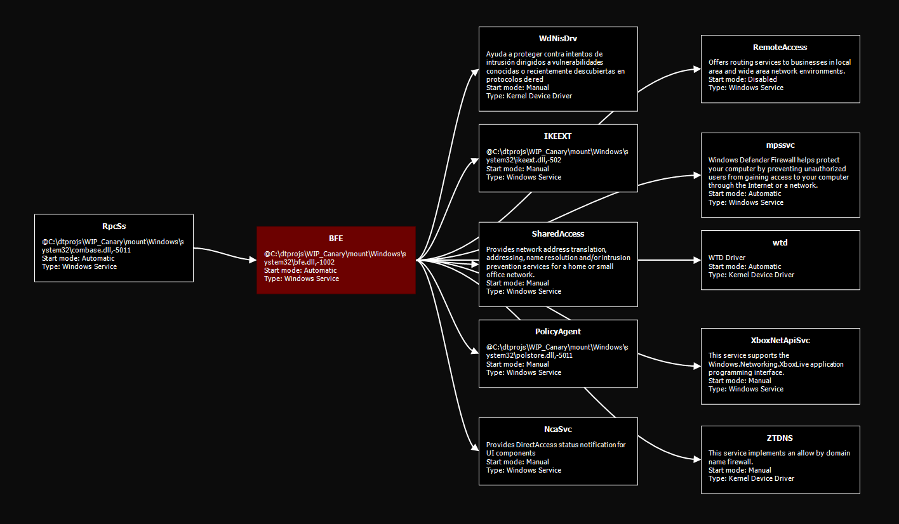
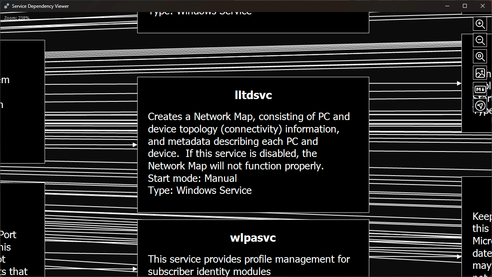

# System Service Manager

The System Service Manager lets you view and modify information about the services in a Windows image. Use the Manager to modify start type properties, or to simply view information about them.

    

You can access the System Service Manager by going to *Tools -> Manage system services*.

*This tool is available in DISMTools 0.7.1 and later.*

!!!note

	 When working with online installations, performing these steps will open the default service panel (`services.msc`), as it is more than enough.

## Service Information available

The System Service Manager displays the following information about each service:

- **Service Information** tab:
    - Service name
    - Display name
    - Description
    - Image Path (Path to executable)
    - Object Name (the account the service runs under)
    - Start Type
    - Delayed Start (**only for Automatic start type**)
    - Service Type (kernel device driver, file system driver, adapter, Windows application, Windows service)
    - User Service Flags (for [per-user services](https://woshub.com/manage-per-user-services-windows/))
- **Required Privileges** tab:
    - Lists the privileges required by the service to run
- **Error Control** tab:
    - Service Control Manager error control (ignore, log but continue, continue starting up in Last Known Good Configuration, or fail startup)
    - Failure Actions:
        - Action on first error
        - Action on second error
        - Action on subsequent errors
        - Reset fail count after (in minutes)
        - Restart service after (in minutes)
- **Service Dependencies** tab:
    - Lists services that depend on this service
    - Lists services that this service depends on

    For both service dependencies and dependents, you will see the service name, the display name, and the service type.
    
- **Service Groups** tab:
    - Lists the group the service belongs to, if any, and other services in the same group
    - Lists registered Service Host (svchost) groups
- **Safe Mode** tab:
    - Allows you to specify whether the service should start in *minimal Safe Mode* (Safe Mode and Safe Mode with Alternate Shell) or *network Safe Mode* (Safe Mode with Networking and Directory Services Restore Mode)
    
    When configuring a service for Safe Mode, you may also need to configure other services that it depends on to start in Safe Mode. If you disable a service in Safe Mode, you can disable its dependents and, optionally, its dependencies.

    

        
    

    
    !!!note

        You must have permission to disable a service in Safe Mode. If you do not have permission, disabling the service will not do anything.
    
    !!!warning

        Make sure that the service you are enabling for Safe Mode is stable. If it is not stable, it can cause Safe Mode to crash.

Some services cannot be configured as they are essential for the system to work properly. These are the essential services:

- `BFE`: Base Filtering Engine
- `CoreMessagingRegistrar`: CoreMessaging
- `CryptSvc`: Cryptographic Services
- `DcomLaunch`: DCOM Server Process Launcher
- `DeviceInstall`: Device Install Service
- `Dhcp`: DHCP Client
- `Dnscache`: DNS Client
- `EventLog`: Windows Event Log
- `gpsvc`: Group Policy Client
- `IKEEXT`: IKE and AuthIP IPsec Keying Modules
- `LanmanWorkstation`: Workstation
- `lmhosts`: TCP/IP NetBIOS Helper
- `LSM`: Local Session Manager
- `mpssvc`: Windows Defender Firewall
- `nsi`: Network Store Interface Service
- `PlugPlay`: Plug and Play
- `Power`: Power
- `ProfSvc`: User Profile Service
- `RpcEptMapper`: RPC Endpoint Mapper
- `RpcSs`: Remote Procedure Call (RPC)
- `SamSs`: Security Accounts Manager
- `SystemEventsBroker`: System Events Broker
- `UserManager`: User Manager

## The Dependency Diagram

Service dependency and dependent relationships can be displayed as a diagram by clicking *View as diagram* from the Dependencies tab. The diagram shows the service in the center, with its dependencies on the left and its dependents on the right.

    

### Controls

Use the following controls to navigate the diagram:

=== "Panning"

    To pan the diagram, click and drag with the left mouse button.

    

    Additionally, you can use the scroll wheel to pan vertically. If your mouse has a horizontal scroll wheel, you can use it as well to pan horizontally.

    

    On trackpads, you can use two-finger drag gestures to pan the diagram vertically and horizontally.

=== "Zooming"

    To zoom in and out of the diagram, hold CTRL and use the scroll wheel. You can also use the + and - keys, in conjunction with CTRL. To reset the zoom level to make all content fit on screen, double-click anywhere on the diagram or press CTRL + 0.

    On trackpads, you can use pinch gestures to zoom in and out. To reset the zoom level, double-tap anywhere on the diagram.

    

=== "Exporting visualizations"

    Use the image and Markdown buttons on the top right corner of the diagram to export the visualization as an image or a Mermaid diagram.

    

=== "Navigating through services"

    To navigate through the service dependency hierarchy, click the navigation button in the top right corner of the diagram and double-click on a service in the dialog.

    

## Modifying a service

You can modify the start type of a service from one of 5 types:

- **Boot Loader**: device drivers that are loaded by the boot loader
- **I/O System**: device drivers that are loaded by the I/O subsystem
- **Automatic**: services that start automatically during system startup
- **Manual**: services that are started manually by the user or by an application
- **Disabled**: services that are disabled and cannot be started

Items marked as Windows applications or services should not have their start types set to Boot Loader or I/O System. When specifying an Automatic start type, you can also check Delayed Start.

This is the only field you can modify for the moment. More modifyable fields may be added in future versions.

To save the new list of services, click *Save*.

## Deleting a service

To delete a service, select it and click *Delete service*. This will mark the service for deletion, and it will be deleted when you save the changes. Services marked for deletion can be cleared of their deletion marks by clicking *Restore service*.

## Saving service information

To save service information to a report, click *Save service information*. This will save a report of the current service configuration to a Markdown file.

## Restoring previous service information

When saving service information, a backup of the current service configuration is created. To restore this backup:

1. Use the Image Registry control panel to load the `SYSTEM` hive of the target image
2. Merge the `.reg` file in your desktop by double-clicking it
3. Unload the `SYSTEM` hive from the control panel and commit the changes

While restoring the backup, you may see an error. This is normal, and many services will be restored correctly despite the error.

It is important that you test your Windows image after modifying services to see if it works as expected. Don't tinker with services too much.